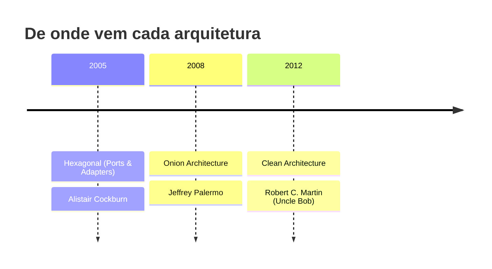
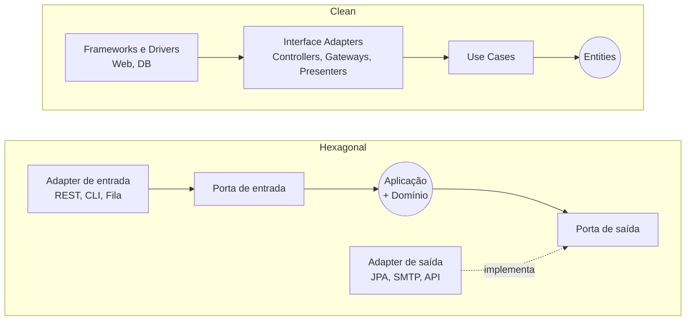
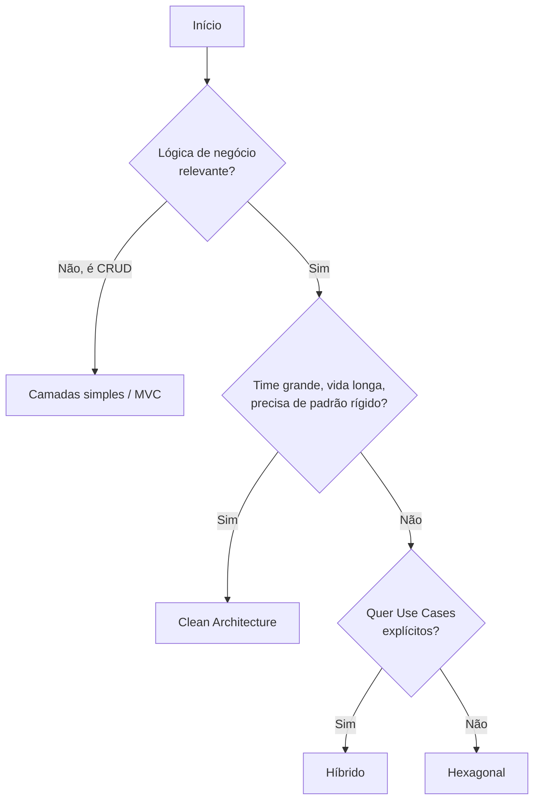

# 🏛️ Clean Architecture vs Hexagonal Architecture
#arquitetura #clean-architecture #hexagonal #comparativo

> [!info] Visão Geral
> Hexagonal (Ports & Adapters) e Clean Architecture nascem da mesma ideia: **o domínio no centro, a tecnologia na borda, e as dependências apontando para dentro**. A diferença está no **nível de detalhe e de prescrição**: a Hexagonal define a fronteira (portas e adaptadores) e deixa o interior livre; a Clean define também as camadas internas (Entities e Use Cases) e declara a Regra de Dependência de forma explícita.

> [!tip] Arquivo extra
> Este é um material complementar. Para estudar cada padrão a fundo, use os glossários no final do arquivo.

---

## 1. Linha do tempo e linhagem



- **Hexagonal (2005):** Cockburn queria uma aplicação que pudesse ser guiada por usuários, programas, testes automatizados ou scripts, e desenvolvida sem depender de banco ou dispositivos.
- **Onion (2008):** Palermo traz as camadas de DDD (Entities, Domain Services, Application Services) em anéis concêntricos.
- **Clean (2012):** Uncle Bob cita Hexagonal, Onion, Screaming Architecture, DCI e BCE como predecessoras e as sintetiza em um modelo único.

Ou seja, a Clean **não é uma rival** da Hexagonal: ela é uma síntese que herda dela a ideia de portas e adaptadores.

---

## 2. Os dois diagramas

**Hexagonal:** só existem "dentro" e "fora". O lado esquerdo guia a aplicação (primary/driving) e o direito é guiado por ela (secondary/driven).

![[img-hexagonal-1.png]]

**Clean:** quatro círculos concêntricos, com a Regra de Dependência apontando para o centro.

![[img-clean-architecture.png]]

Versão simplificada das duas lado a lado:



---

## 3. Glossário de termos: quem é quem

A maior confusão entre os dois padrões é de **vocabulário**. A tabela abaixo mapeia os termos equivalentes.

| Conceito | Hexagonal | Clean Architecture | Observação |
|---|---|---|---|
| Regras centrais do negócio | Domain (Core) | **Entities** | Clean separa Entities de Use Cases; Hexagonal não define o interior |
| Orquestração de um caso de uso | Application Service | **Use Case (Interactor)** | Mesmo papel; na Clean é uma camada de primeira classe |
| Contrato de entrada | Primary/Driving Port | Input Boundary | Interface que o mundo externo usa para acionar a aplicação |
| Contrato de saída | Secondary/Driven Port | Output Boundary / Gateway (interface) | Interface que o núcleo define e a infraestrutura implementa |
| Implementação de entrada | Primary Adapter (REST, CLI, listener) | Controller | Traduz o protocolo externo para chamar o núcleo |
| Implementação de saída | Secondary Adapter (JPA, SMTP, HTTP) | Gateway Implementation | Traduz a chamada do núcleo para a tecnologia |
| Formatação da resposta | Responsabilidade do adapter | **Presenter** | Clean nomeia explicitamente este papel |
| Detalhes técnicos | Fora do hexágono | **Frameworks & Drivers** | Web, banco, dispositivos |
| Direção das dependências | Implícita na ideia de portas | **Dependency Rule** (explícita) | Em ambas, tudo aponta para o núcleo |

> [!note] Pegadinha de nomes
> "Gateway" na Clean ≈ "Secondary Port + Adapter" na Hexagonal. E "Use Case" na Clean ≈ "Application Service" na Hexagonal. São nomes diferentes para o mesmo papel.

---

## 4. Semelhanças

| Princípio | Em ambas |
|---|---|
| Domínio no centro | A regra de negócio não conhece o mundo externo |
| Inversão de Dependência (DIP) | O núcleo define interfaces; a infraestrutura as implementa |
| Testabilidade | O núcleo roda em teste sem banco, web ou broker |
| Independência de framework, UI e banco | Tecnologia é detalhe substituível |
| Várias formas de entrada | A mesma lógica atende REST, CLI, fila ou teste |

---

## 5. Diferenças

| Aspecto | Hexagonal | Clean Architecture |
|---|---|---|
| Foco | A **fronteira**: portas e adaptadores | As **camadas** e a Regra de Dependência |
| Estrutura interna | Não define; cada time decide | Define: Entities e Use Cases |
| Número de camadas | 2 (dentro e fora), na prática 3 | 4 círculos (esquemáticos; podem ser mais) |
| Use Cases | Implícitos (Application Services) | Explícitos, de primeira classe |
| Fluxo de controle | Não detalha | Detalha: Controller → Use Case → Presenter |
| Prescrição | Flexível | Mais prescritiva |
| Custo em código | Menor | Maior (mais objetos de entrada, saída e mapeamento) |
| Origem conceitual | Padrão (Ports & Adapters) | Síntese de Hexagonal, Onion, DCI, BCE e SOLID |

> [!warning] Cuidado com opiniões categóricas
> As fontes divergem. Alguns autores dizem que a Clean é "a Hexagonal com mais detalhes", outros dizem que são essencialmente a mesma coisa. Os dois pontos de vista têm sentido, porque a diferença real é de **granularidade**, não de princípio.

---

## 6. Como combinar (a abordagem híbrida)

Muitos projetos usam **Use Cases explícitos da Clean** com **Ports & Adapters da Hexagonal**:

```
src/
├── domain/          ← Entities (Clean) / Domain (Hexagonal)
├── application/
│   ├── usecases/    ← Use Cases (Clean)
│   └── ports/       ← Ports (Hexagonal): in e out
└── adapters/
    ├── inbound/     ← Controllers, listeners
    └── outbound/    ← Persistência, integrações
```

É uma boa escolha quando o time quer a clareza dos casos de uso, mas prefere o vocabulário de portas e adaptadores.

---

## 7. Quando escolher cada uma



| Cenário | Recomendação |
|---|---|
| Microsserviço com domínio rico, time pequeno ou médio | Hexagonal |
| Sistema grande, vários times, vida longa | Clean |
| Quer Use Cases explícitos, mas com vocabulário de Ports & Adapters | Híbrido |
| CRUD simples sem regra de negócio | Nenhuma das duas (excesso de cerimônia) |

**Erros comuns nas duas:** criar camadas e mapeadores para um CRUD, vazar anotações de framework para o domínio, e tratar o diagrama como lei em vez de guia.

---

## 🔑 Takeaway

A Hexagonal e a Clean Architecture **não competem: se complementam**. A Hexagonal oferece a metáfora simples de fronteira (portas e adaptadores). A Clean acrescenta nomes e camadas para o interior e torna a Regra de Dependência explícita. O que importa é entender o princípio comum, **isolar a regra de negócio dos detalhes técnicos**, e aplicá-lo com consistência.

---

## 🧩 Quiz de Fixação

1. Qual é o princípio compartilhado pelas duas arquiteturas?
2. Que papel da Hexagonal corresponde ao "Use Case" da Clean, e ao "Gateway"?
3. Em que cenário você preferiria a abordagem híbrida?

**Respostas:**
1) Manter o domínio no centro, isolado de framework, UI e banco, com as dependências sempre apontando para dentro, via inversão de dependência.
2) Use Case ≈ Application Service. Gateway ≈ Secondary (driven) Port junto com seu Adapter.
3) Quando o time quer Use Cases explícitos e a clareza de camadas da Clean, mas prefere o vocabulário e a flexibilidade de portas e adaptadores da Hexagonal.

---

## 📚 Fontes
- [Hexagonal Architecture — Alistair Cockburn](https://alistair.cockburn.us/hexagonal-architecture/)
- [The Clean Architecture — Robert C. Martin](https://blog.cleancoder.com/uncle-bob/2012/08/13/the-clean-architecture.html)
- [Clean Architecture: standing on the shoulders of giants — Herberto Graça](https://herbertograca.com/2017/09/28/clean-architecture-standing-on-the-shoulders-of-giants/)
- [Clean Architecture vs Onion vs Hexagonal — Milan Jovanovic](https://milanjovanovic.tech/blog/clean-architecture-vs-onion-vs-hexagonal)

> **Links Relacionados:**
> [[10. Arquitetura de Software e Design de Software/Padrões e Princípios/Padrões Arquiteturais/Hexagonal/0 Hexagonal (Glossário )|Glossário: Arquitetura Hexagonal]]
> [[10. Arquitetura de Software e Design de Software/Padrões e Princípios/Padrões Arquiteturais/Clean architecture/0 Clean Architecture (Glossário )|Glossário: Clean Architecture]]
> [[10. Arquitetura de Software e Design de Software/Padrões e Princípios/Padrões Arquiteturais/Microservices/1. Fundamentos e Contexto/1.1 Conceito e Contexto/1.1.2. Monolito vs Microsserviços/1.1.2.1. Monolítico Modular vs Microsserviços|Monolítico Modular vs Microsserviços]]
