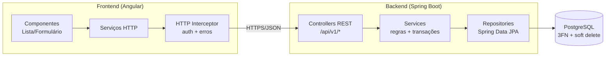

### Agente de Backend, Agente de Frontend e o Eval Harness do Projeto

No tópico anterior (8.1.2.1) montamos o alicerce do Nexus Architect: o **Analista** (que produz o modelo canônico) e o **Agente de Infra** (que entrega o schema SQL em 3ª Forma Normal, compilado em sandbox). Agora fechamos a equipe: o **Agente de Backend** (Java/Spring), o **Agente de Frontend** (Angular, em paralelo, com o diagrama Mermaid da arquitetura) e o **Eval Harness** do projeto, que verifica se tudo **compila, segue REST e tem routing correto**, combinando **métricas binárias** com **LLM-as-judge**.

> [!note] Natureza do material
> O Nexus é um projeto didático. O código mostra **como estruturar** os agentes, as ferramentas e as verificações; versões de Spring Boot, Hibernate, Angular e das bibliotecas de agentes mudam, e nada aqui foi executado como parte deste texto. Confirme APIs na documentação atual.

---

## A topologia completa

```
 modelo canônico (aprovado)  ──►  AGENTE DE INFRA ──► contrato de persistência (DDL validado + tabelas/colunas reais)
                                                          │
                          ┌───────────────────────────────┴───────────────────────────────┐
                          ▼  (fan-out: em PARALELO)                                        ▼
              AGENTE DE BACKEND (Java/Spring)                              AGENTE DE FRONTEND (Angular)
              Entities • Repositories • Services                           Modelos • Serviços HTTP • Componentes
              Controllers REST • DTOs • Soft Delete                        Rotas • Telas CRUD • Diagrama Mermaid
              OpenAPI (contrato)                                           (consome o CONTRATO OpenAPI)
                          └───────────────────────────────┬───────────────────────────────┘
                                                          ▼  (fan-in: junção)
                                              EVAL HARNESS (avaliador)
                                    binárias: compila? REST? routing? consistência?
                                    + LLM-as-judge: aderência ao requisito, qualidade
                                                          │
                              falhas e revisões < teto? ──┴──► volta ao agente responsável (com feedback acionável)
                                                          │ ok / teto
                                                          ▼
                                                   EMPACOTADOR + RELATÓRIO
```

### Por que Backend e Frontend em paralelo

| Fator | Explicação |
|---|---|
| **Dependência comum, não mútua** | Ambos dependem do **modelo canônico** e do **contrato** (OpenAPI), não um do outro |
| **Latência** | Em paralelo, o tempo é o do mais lento, não a soma (4.4.1.1: fan-out/fan-in) |
| **Contrato primeiro (*API-first*)** | O **OpenAPI** é a fronteira: o Frontend gera seu cliente a partir dele, sem esperar o código do Backend |
| **Isolamento de contexto** | Cada agente vê só o que precisa (janela menor, custo menor, menos confusão) |

O ponto de sincronização é a **junção** antes da avaliação, que só roda quando **os dois** terminaram.

> [!tip] Contrato antes do código
> Para o paralelismo funcionar, o **contrato de API** precisa existir **antes** dos agentes. Uma boa prática: o Analista (ou um passo determinístico) deriva do modelo canônico um **OpenAPI preliminar** (recursos, verbos, DTOs). Backend e Frontend **implementam e consomem** esse contrato; o Eval Harness verifica a **conformidade** entre o contrato e cada lado.

---

## Parte 1 — Agente de Backend (Java/Spring)

### Papel

Gerar o **esqueleto do backend**: camadas de persistência, domínio, serviço e API REST, coerentes com o schema do Infra e com o modelo canônico.

| Camada | Artefatos |
|---|---|
| **Domínio/Persistência** | Entities JPA mapeadas às tabelas reais; enums; relacionamentos |
| **Acesso a dados** | Spring Data `Repository` (com filtros de soft delete e multitenancy) |
| **Serviço** | Regras de negócio básicas, transações, validações |
| **API REST** | Controllers, DTOs de entrada/saída, mapeadores, tratamento de erros (`@ControllerAdvice`) |
| **Contrato** | OpenAPI (springdoc), coerente com os controllers |
| **Infra do projeto** | `pom.xml`, `application.yml`, migrations Flyway (do Infra), Dockerfile, README |
| **Testes** | Testes básicos (contexto sobe, repositórios, controllers com MockMvc) |

### Estrutura de pacotes gerada

```
src/main/java/br/com/nexus/clinica/
 ├─ ClinicaApplication.java
 ├─ common/
 │    ├─ BaseEntity.java              ← id, auditoria, soft delete (superclasse)
 │    ├─ TenantContext.java           ← clinica_id corrente (multitenancy)
 │    └─ ApiExceptionHandler.java     ← erros padronizados (RFC 9457)
 ├─ paciente/
 │    ├─ Paciente.java                ← entity
 │    ├─ PacienteRepository.java
 │    ├─ PacienteService.java
 │    ├─ PacienteController.java
 │    └─ dto/ PacienteRequest.java, PacienteResponse.java, PacienteMapper.java
 ├─ consulta/ ... (mesmo padrão)
 └─ procedimento/ ... recibo/ ... dentista/ ...
src/main/resources/ db/migration/V1__schema_inicial.sql   ← vem do Agente de Infra (não reescrito!)
```

### Soft Delete: o requisito transversal

> O enunciado exige **Entities, Repositories, Services e Controllers com Soft Delete**: a exclusão é **lógica** (marcar como excluído), preservando histórico, integridade referencial e atendendo a auditoria/LGPD.

```java
// common/BaseEntity.java — gerado pelo Agente de Backend (Hibernate 6.x / Spring Boot 3.x; confira a versão)
@MappedSuperclass
@Getter @Setter
public abstract class BaseEntity {

    @Id
    @GeneratedValue(strategy = GenerationType.UUID)            // coerente com 'uuid primary key' do DDL
    private UUID id;

    @Column(name = "clinica_id", nullable = false, updatable = false)
    private UUID clinicaId;                                    // multitenancy: preenchido a partir do TenantContext

    @Column(name = "criado_em", nullable = false, updatable = false)
    private OffsetDateTime criadoEm;

    @Column(name = "atualizado_em", nullable = false)
    private OffsetDateTime atualizadoEm;

    @Column(name = "excluido_em")
    private OffsetDateTime excluidoEm;                         // soft delete: null = ativo

    @PrePersist void aoCriar()    { criadoEm = atualizadoEm = OffsetDateTime.now(); clinicaId = TenantContext.require(); }
    @PreUpdate  void aoAtualizar() { atualizadoEm = OffsetDateTime.now(); }
}
```

```java
// paciente/Paciente.java
@Entity
@Table(name = "paciente")
@SQLDelete(sql = "update paciente set excluido_em = now() where id = ?")        // DELETE vira UPDATE (exclusão lógica)
@SQLRestriction("excluido_em is null")                                          // todo SELECT já filtra excluídos
// (em Hibernate < 6.3 usa-se @Where(clause = "excluido_em is null"))
@Getter @Setter
public class Paciente extends BaseEntity {

    @Column(nullable = false, length = 150)
    private String nome;

    @Column(nullable = false, length = 11)
    private String cpf;                                                          // dado sensível (LGPD)

    @Column(name = "data_nascimento")
    private LocalDate dataNascimento;

    @OneToMany(mappedBy = "paciente")
    private List<Consulta> consultas = new ArrayList<>();
}
```

```java
// paciente/PacienteRepository.java
public interface PacienteRepository extends JpaRepository<Paciente, UUID> {
    // Com @SQLRestriction, as consultas derivadas já excluem os 'excluidos'. O filtro por tenant vem de um Filter/Specification.
    Page<Paciente> findByClinicaIdAndNomeContainingIgnoreCase(UUID clinicaId, String nome, Pageable pageable);
}
```

```java
// paciente/PacienteController.java — REST: recursos no plural, verbos e status corretos
@RestController
@RequestMapping("/api/v1/pacientes")
@RequiredArgsConstructor
@Validated
public class PacienteController {

    private final PacienteService service;

    @GetMapping                       public Page<PacienteResponse> listar(@RequestParam(defaultValue = "") String nome, Pageable p) { return service.listar(nome, p); }
    @GetMapping("/{id}")              public PacienteResponse buscar(@PathVariable UUID id) { return service.buscar(id); }          // 404 se não existir/excluído

    @PostMapping
    public ResponseEntity<PacienteResponse> criar(@Valid @RequestBody PacienteRequest req, UriComponentsBuilder uri) {
        var criado = service.criar(req);
        return ResponseEntity.created(uri.path("/api/v1/pacientes/{id}").buildAndExpand(criado.id()).toUri()).body(criado);   // 201 + Location
    }

    @PutMapping("/{id}")              public PacienteResponse atualizar(@PathVariable UUID id, @Valid @RequestBody PacienteRequest req) { return service.atualizar(id, req); }

    @DeleteMapping("/{id}")
    @ResponseStatus(HttpStatus.NO_CONTENT)                                            // 204: exclusão (lógica) sem corpo
    public void excluir(@PathVariable UUID id) { service.excluir(id); }
}
```

### O que o Agente de Backend consome e como se mantém consistente

| Entrada | Uso |
|---|---|
| **Modelo canônico** | Entidades, atributos, relacionamentos, regras, `soft_delete`, `sensivel` |
| **Contrato de persistência do Infra** | **Nomes reais de tabelas e colunas**, tipos, constraints: as `@Column`/`@Table` **vêm daqui**, nunca "inventadas" |
| **OpenAPI preliminar** | Recursos, verbos e DTOs que os controllers devem expor |
| **Convenções do Nexus** | Pacotes, nomenclatura, REST, tratamento de erros, paginação |

A regra de ouro (ADR-1, 8.1.1.1): **nenhum nome ou tipo nasce no Backend**; tudo é derivado do modelo canônico/contrato de persistência. Assim, o verificador de consistência encontra divergências como falha objetiva.

### Geração: LLM + templates determinísticos

Código repetitivo e padronizado (CRUD) é um caso clássico em que **templates determinísticos** superam o LLM em custo e confiabilidade. A abordagem híbrida recomendada:

```
                 ┌───────────────────────────────────────────────────────────┐
 modelo + DDL ──►│ GERADOR DETERMINÍSTICO (templates): CRUD, entities, DTOs,  │──► ~80% do código (confiável, barato)
                 │ repositories, controllers REST, OpenAPI                    │
                 └───────────────────────────────────────────────────────────┘
                 ┌───────────────────────────────────────────────────────────┐
 regras de      ─►│ LLM (modelo médio): regras de negócio específicas,         │──► ~20% (onde há semântica)
 negócio         │ validações, serviços não triviais, testes de regras        │
                 └───────────────────────────────────────────────────────────┘
```

Isso reflete o princípio do grafo: **LLM só onde há semântica; código onde há regra** (4.4.2.1).

### Ferramentas do Agente de Backend (sandbox, 5.1.3.1)

| Ferramenta | Função |
|---|---|
| `escrever_arquivo(caminho, conteudo)` | Escreve no **workspace isolado** do projeto (somente dentro dele) |
| `compilar_backend()` | `mvn -q -DskipTests compile` no sandbox; devolve erros do compilador (arquivo, linha) |
| `rodar_testes()` | `mvn -q test` (com banco efêmero) |
| `validar_openapi()` | Gera o OpenAPI do código e compara com o contrato |
| `analise_estatica()` | Checkstyle/SpotBugs/SAST; detecta segredos e padrões inseguros |
| `resolver_dependencias()` | Resolve o `pom.xml` contra **espelho/lista permitida** (evita pacotes inventados) |

**Controles:** sandbox **sem rede** (dependências via espelho interno), sem segredos, limites de CPU/memória/tempo; o agente **não** executa o código gerado fora do contêiner.

### O laço do Backend

```
gera/ajusta código ─► compila (mvn) ─► erros do compilador específicos ─► corrige ─► ... (teto: 4 tentativas)
                          │ ok
                          ▼
                    roda testes básicos ─► falhas ─► corrige (teto) ─► ok ─► entrega
```

O feedback é o **erro real do compilador** ("`cannot find symbol: method getExcluidoEm()` em `PacienteService.java:41`"): específico, acionável, determinístico (4.3.2.1).

### Riscos do Backend

| Risco | Mitigação |
|---|---|
| **Alucinação de APIs/bibliotecas** (métodos ou dependências inexistentes) | Compilar de verdade; resolver dependências contra lista permitida |
| **Divergência com o schema** | `@Column/@Table` derivados do contrato do Infra; verificador de consistência |
| **Soft delete incompleto** (consultas que retornam excluídos; `DELETE` físico) | Teste automático: excluir → não aparece no `GET`; linha permanece no banco |
| **Vazamento entre tenants** | Filtro de `clinica_id` obrigatório; teste de isolamento |
| **Código inseguro** (SQL concatenado, segredos, CORS aberto) | SAST + regras; uso de JPA/parâmetros |
| **Exposição de dados sensíveis** em DTOs/logs | Marcar `sensivel`; DTOs sem campos desnecessários; mascarar em logs |
| **REST fora do padrão** | Verificador de REST (OpenAPI lint) |

---

## Parte 2 — Agente de Frontend (Angular)

### Papel

Gerar o **frontend** (telas CRUD, serviços, rotas) e o **diagrama de arquitetura em Mermaid**, **em paralelo** com o Backend, consumindo o **contrato OpenAPI**.

| Artefato | Conteúdo |
|---|---|
| **Modelos/Interfaces TypeScript** | Tipos derivados do OpenAPI/modelo canônico (mesmos nomes dos DTOs) |
| **Serviços HTTP** | `HttpClient` por recurso, apontando para as rotas do contrato |
| **Componentes** | Listagem (tabela com paginação), formulário (validações), detalhe |
| **Roteamento** | `app.routes.ts` com rotas para cada tela; *lazy loading* por feature |
| **Layout** | Menu/navegação, tratamento de erro e *loading* |
| **Diagrama Mermaid da arquitetura** | Componentes do sistema (frontend, API, banco) e fluxos |
| **Infra do projeto** | `package.json`, `angular.json`, ambientes, README |

### Estrutura gerada

```
src/app/
 ├─ app.config.ts · app.routes.ts · app.component.ts
 ├─ core/ http-error.interceptor.ts · api.config.ts
 ├─ shared/ ui (tabela, paginação, confirmação)
 └─ features/
     ├─ pacientes/
     │    ├─ paciente.model.ts           ← interface (derivada do OpenAPI)
     │    ├─ paciente.service.ts         ← HttpClient → /api/v1/pacientes
     │    ├─ paciente-lista.component.ts
     │    ├─ paciente-form.component.ts
     │    └─ pacientes.routes.ts
     ├─ consultas/ ... procedimentos/ ... recibos/ ...
```

### Exemplo gerado (componentes standalone e rotas)

```typescript
// features/pacientes/paciente.service.ts
@Injectable({ providedIn: 'root' })
export class PacienteService {
  private readonly http = inject(HttpClient);
  private readonly base = `${environment.apiUrl}/api/v1/pacientes`;          // MESMO caminho do contrato OpenAPI

  listar(nome = '', page = 0, size = 20) {
    return this.http.get<Page<Paciente>>(this.base, { params: { nome, page, size } });
  }
  buscar(id: string)                      { return this.http.get<Paciente>(`${this.base}/${id}`); }
  criar(p: PacienteRequest)               { return this.http.post<Paciente>(this.base, p); }
  atualizar(id: string, p: PacienteRequest) { return this.http.put<Paciente>(`${this.base}/${id}`, p); }
  excluir(id: string)                     { return this.http.delete<void>(`${this.base}/${id}`); }
}
```

```typescript
// features/pacientes/pacientes.routes.ts
export const PACIENTES_ROUTES: Routes = [
  { path: '',        component: PacienteListaComponent },
  { path: 'novo',    component: PacienteFormComponent },
  { path: ':id',     component: PacienteFormComponent },        // edição
];

// app.routes.ts — cada feature com rota e carregamento sob demanda
export const routes: Routes = [
  { path: '', pathMatch: 'full', redirectTo: 'pacientes' },
  { path: 'pacientes',     loadChildren: () => import('./features/pacientes/pacientes.routes').then(m => m.PACIENTES_ROUTES) },
  { path: 'consultas',     loadChildren: () => import('./features/consultas/consultas.routes').then(m => m.CONSULTAS_ROUTES) },
  { path: 'procedimentos', loadChildren: () => import('./features/procedimentos/procedimentos.routes').then(m => m.PROCEDIMENTOS_ROUTES) },
  { path: 'recibos',       loadChildren: () => import('./features/recibos/recibos.routes').then(m => m.RECIBOS_ROUTES) },
  { path: '**', redirectTo: 'pacientes' },
];
```

(Sintaxe de Angular moderna, com componentes *standalone* e `inject()`; versões variam: confirme na documentação.)

### O diagrama de arquitetura em Mermaid

O Frontend também entrega o **diagrama de arquitetura**, **gerado a partir da estrutura real do projeto** (módulos, serviços, endpoints) e não de uma "imaginação" do LLM, sempre que possível.



| Boa prática do diagrama | Motivo |
|---|---|
| **Gerar a partir de dados reais** (rotas do Angular, controllers do OpenAPI, tabelas do schema) | Evita diagramas inventados |
| **Validar a sintaxe** com o parser do Mermaid (`mmdc`/`mermaid.parse`) | Diagrama inválido = não renderiza |
| **Coerência com o ER do Infra** | Entidades do diagrama = tabelas do banco |
| **Texto sem caracteres que quebram o Mermaid** (aspas, parênteses em rótulos) | Erros de sintaxe comuns |

### Ferramentas do Agente de Frontend

| Ferramenta | Função |
|---|---|
| `escrever_arquivo` | Escreve no workspace isolado |
| `gerar_cliente_openapi(contrato)` | Gera **tipos e serviços** a partir do OpenAPI (ex.: `openapi-generator`/`ng-openapi-gen`), garantindo aderência ao contrato |
| `compilar_frontend()` | `ng build` (ou `tsc --noEmit`) no sandbox |
| `lint_frontend()` | ESLint/Angular lint |
| `validar_rotas()` | Analisa `app.routes.ts`: cada feature tem rota; sem rotas quebradas |
| `validar_mermaid(codigo)` | Parser do Mermaid |

### Riscos do Frontend

| Risco | Mitigação |
|---|---|
| **Divergência do contrato** (URLs, campos, tipos) | **Gerar** modelos/serviços a partir do OpenAPI; verificar conformidade |
| **Rotas quebradas ou ausentes** | `validar_rotas()`; teste: toda tela do plano tem rota e componente existente |
| **Dependências inventadas** (pacotes npm inexistentes) | Resolver contra espelho/lista permitida; `npm install` em sandbox sem rede externa livre |
| **XSS e uso inseguro de `innerHTML`/`bypassSecurityTrust*`** | Regras de lint e SAST |
| **Armazenar segredos/tokens de forma insegura** | Convenções do Nexus; revisão |
| **UI incoerente** com os dados sensíveis | Mascarar CPF em listagens; aviso LGPD |

---

## Parte 3 — O Eval Harness do projeto

### Objetivo

O Eval Harness é o **avaliador** do grafo (4.4.3.1): mede se o **resultado final** (SQL + Backend + Frontend + diagramas) atende aos **critérios de aceitação** da especificação (8.1.1.1) e **devolve feedback acionável** para o ciclo de revisão. Segue o princípio do Loop Engineering: **preferir verificação determinística e independente**, usando LLM-as-judge apenas onde há julgamento (4.3.2.1, 7.1.2.1).

```
                    ┌────────────────────────── EVAL HARNESS DO NEXUS ──────────────────────────┐
 pacote gerado ───► │ A) MÉTRICAS BINÁRIAS (determinísticas, em sandbox)                         │
 (SQL, Java,        │    1. SQL compila?        2. Backend compila?     3. Angular compila?       │
  Angular,          │    4. Endpoints seguem REST?   5. Routing do Angular correto?              │
  Mermaid,          │    6. Consistência modelo ↔ SQL ↔ Entities ↔ OpenAPI ↔ Angular             │
  OpenAPI)          │    7. Mermaid válido?    8. Soft delete funciona?    9. Sem segredos/SAST  │
                    │ B) LLM-AS-JUDGE (rubrica, juiz independente)                               │
                    │    cobertura do requisito • aderência ao modelo • qualidade/legibilidade    │
                    │ C) CUSTO e TEMPO                                                           │
                    └─────────────────────────────┬──────────────────────────────────────────────┘
                                                  ▼
                       RELATÓRIO (notas, falhas por agente, feedback) → roteamento: revisar ou empacotar
```

### A) Métricas binárias (a espinha dorsal)

Cada métrica é **passa/falha**, executada por código em sandbox, e **atribuída a um agente** (para o feedback voltar ao responsável certo).

| # | Métrica | Como verifica | Agente responsável | Exemplo de feedback |
|---|---|---|---|---|
| **B1** | **SQL compila** | Executa o DDL em Postgres efêmero | Infra | `ERRO: relation "dentista" does not exist (V1__schema.sql:42)` |
| **B2** | **Backend compila** | `mvn -q compile` | Backend | `cannot find symbol: getExcluidoEm() em PacienteService.java:41` |
| **B3** | **Frontend compila** | `ng build` | Frontend | `TS2339: Property 'cpf' does not exist on type 'Paciente'` |
| **B4** | **Endpoints seguem REST** | Lint do OpenAPI (regras abaixo) | Backend | `POST /api/v1/criarPaciente viola: verbos no caminho` |
| **B5** | **Routing correto no Angular** | Analisa rotas e componentes (regras abaixo) | Frontend | `Rota 'recibos' sem componente; 'consultas/:id' inexistente` |
| **B6** | **Consistência entre artefatos** | Cruza nomes/tipos/campos (matriz abaixo) | Dono da divergência | `Entity Paciente.dataNasc ≠ coluna data_nascimento` |
| **B7** | **Mermaid válido** | Parser do Mermaid | Frontend | `Parse error na linha 7` |
| **B8** | **Soft delete funcional** | Teste de integração: `DELETE` → `GET` retorna 404, linha segue no banco com `excluido_em` | Backend | `DELETE removeu fisicamente a linha` |
| **B9** | **Segurança estática** | SAST, scanner de segredos, dependências conhecidas vulneráveis | Backend/Frontend | `Segredo hardcoded em application.yml` |
| **B10** | **3FN (heurísticas)** | Analisador de normalização (8.1.2.1) | Infra | `consulta.paciente_nome redundante` |

#### Regras de REST verificadas (B4)

```
✔ Recursos são SUBSTANTIVOS no PLURAL (/pacientes), sem verbos no caminho
✔ Verbos HTTP corretos: GET (ler), POST (criar → 201 + Location), PUT/PATCH (atualizar), DELETE (→ 204)
✔ Códigos de status coerentes: 200/201/204; 400 (validação), 404 (inexistente), 409 (conflito), 422, 500
✔ Coleções paginadas (page/size) e filtros por query string
✔ Versionamento no caminho (/api/v1)
✔ Erros padronizados (RFC 9457: type, title, status, detail)
✔ IDs no caminho (/pacientes/{id}); subrecursos coerentes (/pacientes/{id}/consultas)
✔ Idempotência: PUT/DELETE idempotentes; POST com Idempotency-Key quando aplicável
```

Implementação: **lint do OpenAPI** com regras customizadas (ex.: **Spectral**) + testes sobre o contrato extraído do código.

```yaml
# .spectral.yaml (esboço) — regras REST do Nexus
extends: ["spectral:oas"]
rules:
  caminho-sem-verbo:
    description: "Caminhos não devem conter verbos"
    given: "$.paths[*]~"
    severity: error
    then: { function: pattern, functionOptions: { notMatch: "/(criar|listar|buscar|atualizar|excluir|deletar|get|set)[A-Z]?" } }
  recurso-no-plural:
    description: "O primeiro segmento deve estar no plural"
    given: "$.paths[*]~"
    severity: warn
    then: { function: pattern, functionOptions: { match: "^/api/v[0-9]+/[a-z-]+s(/.*)?$" } }
  post-retorna-201:
    given: "$.paths[*].post.responses"
    severity: error
    then: { field: "201", function: truthy }
```

#### Verificação de routing do Angular (B5)

```
1. Parsear app.routes.ts (AST do TypeScript) e as rotas filhas (loadChildren).
2. Para cada feature do PLANO: existe rota-base?  (pacientes, consultas, procedimentos, recibos)
3. Para cada rota: o componente referenciado EXISTE e é exportado?  (sem imports quebrados)
4. Não há rotas duplicadas nem 'redirectTo' circular.
5. Os links do menu (routerLink) apontam para rotas existentes.
6. Navegação smoke test (opcional): subir o app em sandbox com Playwright e visitar cada rota (sem erro 404/console).
```

```python
def checar_routing(plano, rotas_extraidas, componentes_existentes) -> list[str]:
    erros = []
    for feature in plano.features:                                               # ex.: pacientes, consultas...
        if feature not in rotas_extraidas.bases:
            erros.append(f"Feature '{feature}' sem rota em app.routes.ts")
    for rota in rotas_extraidas.todas:
        if rota.componente and rota.componente not in componentes_existentes:
            erros.append(f"Rota '{rota.path}' referencia componente inexistente: {rota.componente}")
    duplicadas = {p for p in rotas_extraidas.paths if rotas_extraidas.paths.count(p) > 1}
    erros += [f"Rota duplicada: {p}" for p in duplicadas]
    return erros                                                                  # volta ao Agente de Frontend
```

#### Matriz de consistência (B6): o coração do projeto

| Fonte → Destino | O que se confere |
|---|---|
| **Modelo canônico → DDL** | Toda entidade tem tabela; atributos têm colunas com tipos compatíveis; FKs existem |
| **DDL → Entities JPA** | `@Table/@Column` apontam para tabelas/colunas **reais**; tipos Java compatíveis com os SQL |
| **Entities → DTOs/OpenAPI** | Campos expostos coerentes; dados `sensivel` não vazam sem necessidade |
| **OpenAPI → Controllers** | Todo endpoint do contrato existe e vice-versa |
| **OpenAPI → Serviços Angular** | URLs, verbos e tipos idênticos |
| **Modelo → Telas Angular** | Cada entidade com telas CRUD e campos de formulário correspondentes |
| **Modelo/DDL → Mermaid ER** | Entidades e relacionamentos do diagrama = schema |

```python
def checar_consistencia_campos(modelo, ddl_esquema, entities, openapi, ts_models) -> list[str]:
    erros = []
    for ent in modelo.entidades:
        tab = ddl_esquema.tabela_de(ent.nome)
        if not tab:
            erros.append(f"[Infra] Entidade {ent.nome} sem tabela."); continue
        for a in ent.atributos:
            col = tab.coluna_de(a.nome)
            if not col:
                erros.append(f"[Infra] {ent.nome}.{a.nome} sem coluna em {tab.nome}.")
            elif not tipo_compativel(a.tipo, col.tipo):
                erros.append(f"[Infra] {tab.nome}.{col.nome}: tipo {col.tipo} incompatível com {a.tipo}.")
            if a.nome not in entities[ent.nome].campos:
                erros.append(f"[Backend] Entity {ent.nome} sem campo {a.nome}.")
            if a.nome not in openapi.schema(ent.nome + "Response").propriedades:
                erros.append(f"[Backend] OpenAPI {ent.nome}Response sem {a.nome}.")
            if a.nome not in ts_models[ent.nome].campos:
                erros.append(f"[Frontend] Interface {ent.nome} sem {a.nome}.")
    return erros              # o prefixo [Agente] roteia o feedback ao dono da divergência
```

### B) LLM-as-a-Judge: o que só um modelo avalia

Algumas qualidades **não são verificáveis por regra**. Para elas, usa-se um **juiz independente** (outra família/modelo que o dos geradores, contexto limpo, rubrica, saída estruturada; 7.1.2.2).

| Dimensão | Pergunta | Escala |
|---|---|---|
| **Cobertura do requisito** | Cada requisito (R1..Rn) está implementado em alguma tela/endpoint/tabela? (usa a rastreabilidade) | 1–5 + lista de requisitos descobertos |
| **Aderência ao modelo e às regras de negócio** | As regras do modelo (ex.: "CPF único por clínica", "sem conflito de horário") aparecem no código e no schema? | 1–5 |
| **Qualidade e legibilidade** | Código organizado, nomes claros, sem duplicação evidente, convenções do projeto? | 1–5 |
| **Adequação da arquitetura** | O diagrama reflete a estrutura real? Camadas respeitadas? | 1–5 |
| **Qualidade do README** | Instruções de build/run claras e completas? | 1–5 |
| **Segurança por inspeção** | Há riscos que o SAST não pega (autorização ausente, exposição de dados sensíveis)? | 1–5 |

```python
class Julgamento(BaseModel):
    criterio: Literal["cobertura", "regras_negocio", "qualidade", "arquitetura", "readme", "seguranca"]
    nota: int = Field(ge=1, le=5)
    evidencias: list[str]                       # trechos/arquivos que sustentam a nota
    problemas: list[str]                        # específicos e acionáveis, com o agente responsável

PROMPT_JUIZ = """Você é um revisor técnico rigoroso e independente. Avalie o critério '{criterio}' do projeto gerado.
Use a RÚBRICA abaixo; procure ATIVAMENTE por problemas; cite evidências (arquivo:trecho).
Não considere o raciocínio dos geradores, apenas os artefatos.
Rubrica: {rubrica}
Requisitos (R1..Rn) e modelo: {modelo}
Artefatos relevantes: {artefatos}
Responda no schema."""
```

**Cuidados do juiz** (7.1.2.2): juiz de **família diferente** (evita autopreferência), **temperatura 0**, rubrica com **âncoras**, **calibração com humanos** em um subconjunto, e **nunca** como única barreira para o que pode ser checado por código.

### C) Agregação, decisão e feedback

```python
PESOS = {"compila_sql": 1, "compila_backend": 1, "compila_frontend": 1, "rest": 1, "routing": 1,
         "consistencia": 1, "mermaid": 1, "soft_delete": 1, "seguranca": 1}
MINIMOS_BLOQUEANTES = ["compila_sql", "compila_backend", "compila_frontend", "seguranca"]   # não negociáveis

def decidir(binarias: dict[str, bool], juiz: dict[str, int], revisoes: int, teto: int = 2) -> str:
    # 1) Falha em mínimo bloqueante? precisa de revisão (ou ressalva se o teto esgotou)
    falhas_bloq = [m for m in MINIMOS_BLOQUEANTES if not binarias[m]]
    nota_binaria = sum(binarias.values()) / len(binarias)
    nota_juiz = sum(juiz.values()) / (5 * len(juiz))                           # 0..1
    nota = 0.7 * nota_binaria + 0.3 * nota_juiz                                # binárias pesam mais (objetivas)
    if (falhas_bloq or nota < 0.85) and revisoes < teto:
        return "revisar"                                                       # TETO na estrutura do grafo (4.4.3.1)
    if falhas_bloq:
        return "reprovado"                                                     # esgotou revisões e ainda não compila
    return "aprovado" if nota >= 0.85 else "aprovado_com_ressalvas"
```

| Resultado | Significado | Ação |
|---|---|---|
| **aprovado** | Todos os mínimos atendidos, nota ≥ 0,85 | Empacota |
| **aprovado_com_ressalvas** | Compila e é seguro, mas com pendências (listadas) | Empacota com **relatório de ressalvas** |
| **revisar** | Falhas corrigíveis e revisões < teto | Roteia **cada falha ao agente dono**, com feedback específico |
| **reprovado** | Mínimo bloqueante falhou após o teto | Não entrega código; devolve diagnóstico (e eventualmente escala a humano) |

### O ciclo de revisão (avaliador-otimizador, 4.4.3.1)

```
EVAL ─► falhas por agente:  Infra: [B1, B10]   Backend: [B2, B4, B8]   Frontend: [B5]
          │
          ▼ roteamento condicional (CÓDIGO): só os agentes com falhas são reacionados (e em paralelo)
   Infra corrige ─┐
   Backend corrige ┼─► junção ─► EVAL de novo (revisões + 1) ─► ... ─► teto (2) ─► decisão final
   Frontend corrige┘
```

Pontos de projeto: **revisar só o que falhou** (economia), **feedback específico** (mensagem do compilador/lint), **teto de revisões no grafo**, e **guardar a melhor versão** (se a revisão 2 for pior que a 1, entregar a 1).

### Orçamento e observabilidade do harness

| Item | Prática |
|---|---|
| **Custo do harness** | Verificações determinísticas ≈ custo de computação; LLM-juiz limitado a ~6 chamadas curtas por execução (modelo intermediário) |
| **Traces** (7.1.1.1) | `node_id=eval`, notas por métrica, falhas por agente, versão da rubrica e do juiz |
| **Relatório versionado** | Salvo como artefato A8 (8.1.1.1): reproduzível |
| **Métricas do sistema** | Taxa de compilação na 1ª tentativa por agente; revisões médias; % em cada resultado; custo por execução |
| **Golden dataset** (7.1.2.2) | Conjunto de requisitos de referência (simples a adversariais) rodando em CI a cada mudança de prompt/modelo/grafo; **queda > 5% bloqueia** |

---

## Execução paralela e junção no LangGraph (esboço)

```python
from langgraph.graph import StateGraph, START, END

g = StateGraph(Estado)
g.add_node("analista", analista); g.add_node("aprovacao", aprovacao_humana); g.add_node("infra", agente_infra)
g.add_node("backend", agente_backend); g.add_node("frontend", agente_frontend); g.add_node("eval", eval_harness)
g.add_node("empacotar", empacotar)

g.add_edge(START, "analista")
g.add_edge("analista", "aprovacao")
g.add_conditional_edges("aprovacao", rotear_aprovacao, {"infra": "infra", END: END})
g.add_edge("infra", "backend")                      # fan-out: backend e frontend começam juntos após a infra
g.add_edge("infra", "frontend")
g.add_edge("backend", "eval")                       # fan-in: eval só roda quando AMBOS terminaram
g.add_edge("frontend", "eval")
g.add_conditional_edges("eval", rotear_revisao,     # decisão em CÓDIGO: revisar (quais agentes) / empacotar / reprovar
                        {"infra": "infra", "backend": "backend", "frontend": "frontend",
                         "empacotar": "empacotar", END: END})
g.add_edge("empacotar", END)

app = g.compile(checkpointer=PostgresSaver.from_conn_string(DSN))      # persistência: HITL e retomada
```

(Sintaxe ilustrativa; o LangGraph aguarda todos os nós que alimentam um nó de junção. Confirme o comportamento exato de *fan-in* na versão em uso. Em CrewAI, equivalente: tarefas paralelas com `async_execution=True` e uma tarefa de avaliação com `context=[...]`.)

---

## Exemplo prático: uma execução completa (clínica odontológica)

```
14:03:11  POST /v1/projetos  →  prj_01J...  (guardrails de entrada: ok)
14:03:20  ANALISTA: 7 entidades, 4 épicos, 3 premissas, 2 perguntas em aberto; validação determinística ok.
14:03:21  HITL: plano enviado; usuário edita a premissa de recibo e aprova.        (espera: 4 min)
14:07:30  INFRA: tentativa 1 falhou (relation "dentista" does not exist) → tentativa 2 ok; 3FN: 0 violações.
14:08:10  BACKEND ∥ FRONTEND (em paralelo):
            Backend: templates CRUD + LLM para a regra de conflito de horário; mvn compile ok (tentativa 2).
            Frontend: serviços gerados do OpenAPI; ng build ok; Mermaid válido.
14:09:40  EVAL (revisão 0):
            B1 ✔  B2 ✔  B3 ✔  B4 ✘ (POST /api/v1/emitirRecibo)  B5 ✘ (rota 'recibos' sem componente)
            B6 ✘ (Consulta.status: enum no Java, varchar no DDL sem CHECK)  B7 ✔  B8 ✔  B9 ✔  B10 ✔
            Juiz: cobertura 4, regras 3 (conflito de horário sem teste), qualidade 4 → nota 0,78 → REVISAR.
14:09:41  Roteamento: Backend ← [B4, B6 (enum), regra de conflito]; Frontend ← [B5]; Infra ← [B6: CHECK do status].
14:11:05  EVAL (revisão 1): todas as binárias ✔; juiz: cobertura 5, regras 4, qualidade 4 → nota 0,91 → APROVADO.
14:11:20  EMPACOTADOR: zip com diagramas, SQL, backend, frontend, OpenAPI, README e relatório.
Custo total: US$ 1,74 | tempo: 8 min (4 min de espera humana) | 1 revisão | tentativas: infra 2, backend 2, frontend 1.
Relatório: "Aprovado. Ressalvas: pagamento parcelado e emissão fiscal fora do escopo; teste de concorrência de agenda não gerado."
```

(Execução ilustrativa para explicar o fluxo; não é saída real de um sistema executado.)

---

## Erros comuns e armadilhas

- **Backend e Frontend inventando nomes e tipos** em vez de derivá-los do modelo canônico e do contrato.
- **Gerar tudo com LLM** (inclusive o CRUD repetitivo) em vez de templates determinísticos: caro e inconsistente.
- **Sem contrato OpenAPI antes do paralelismo**: o Frontend precisa "esperar" o Backend ou adivinha.
- **Soft delete só na teoria**: `DELETE` físico, consultas retornando excluídos, sem teste que prove.
- **Esquecer o filtro de tenant** nos repositórios/queries.
- **Dependências inventadas** (Maven/npm) por falta de resolução contra lista permitida.
- **Avaliar só por LLM-juiz**; ou juiz da mesma família dos geradores.
- **Feedback genérico** ("o backend falhou") em vez do erro específico do compilador/lint com o agente dono.
- **Revisar tudo de novo** quando só um agente falhou (custo e risco de regressões).
- **Sem teto de revisões** na estrutura; sem guardar a melhor versão.
- **Mermaid inventado**, sem validar a sintaxe e sem coerência com o schema real.
- **Executar código gerado fora de sandbox** ou com rede e segredos.
- **Aprovar sem relatório honesto** de ressalvas: falsa sensação de "sistema pronto".
- **Sem golden dataset em CI**: mudanças de prompt/modelo degradam a qualidade sem aviso.

---

## 🧩 Quiz de Fixação

1. Por que Backend e Frontend rodam em paralelo e que artefato torna isso possível? Onde ocorre a junção?
2. Cite quatro métricas binárias do Eval Harness do Nexus e explique por que elas pesam mais do que o LLM-as-judge.
3. Como funciona o ciclo de revisão (quem é reacionado, com que feedback, qual o teto) e por que o resultado "aprovado_com_ressalvas" existe?

**Respostas:**
1) Porque ambos dependem do modelo canônico e do contrato OpenAPI (API-first), não um do outro; o contrato é a fronteira: o Backend o implementa e o Frontend gera seus tipos e serviços a partir dele, reduzindo a latência (fan-out). A junção (fan-in) ocorre antes do Eval Harness, que só roda quando os dois terminaram.
2) Por exemplo: SQL compila (Postgres efêmero), backend compila (mvn), frontend compila (ng build), endpoints seguem REST (lint do OpenAPI), routing do Angular correto, consistência entre artefatos, Mermaid válido, soft delete funcional e segurança estática. Pesam mais porque são objetivas, determinísticas, baratas e independentes de quem gerou o código, enquanto o LLM-juiz é probabilístico, tem vieses e deve complementar apenas o que exige julgamento (cobertura do requisito, qualidade, regras de negócio).
3) O Eval atribui cada falha ao agente responsável (Infra, Backend ou Frontend) com feedback específico (erro do compilador/lint, regra violada) e o roteamento condicional em código reaciona apenas os agentes com falhas, em paralelo, até o teto de revisões (por exemplo, 2) definido na estrutura do grafo, guardando a melhor versão. O resultado "aprovado_com_ressalvas" existe para entregar um esqueleto que compila e é seguro, mas com pendências listadas de forma honesta no relatório, evitando falsa sensação de sistema pronto.
